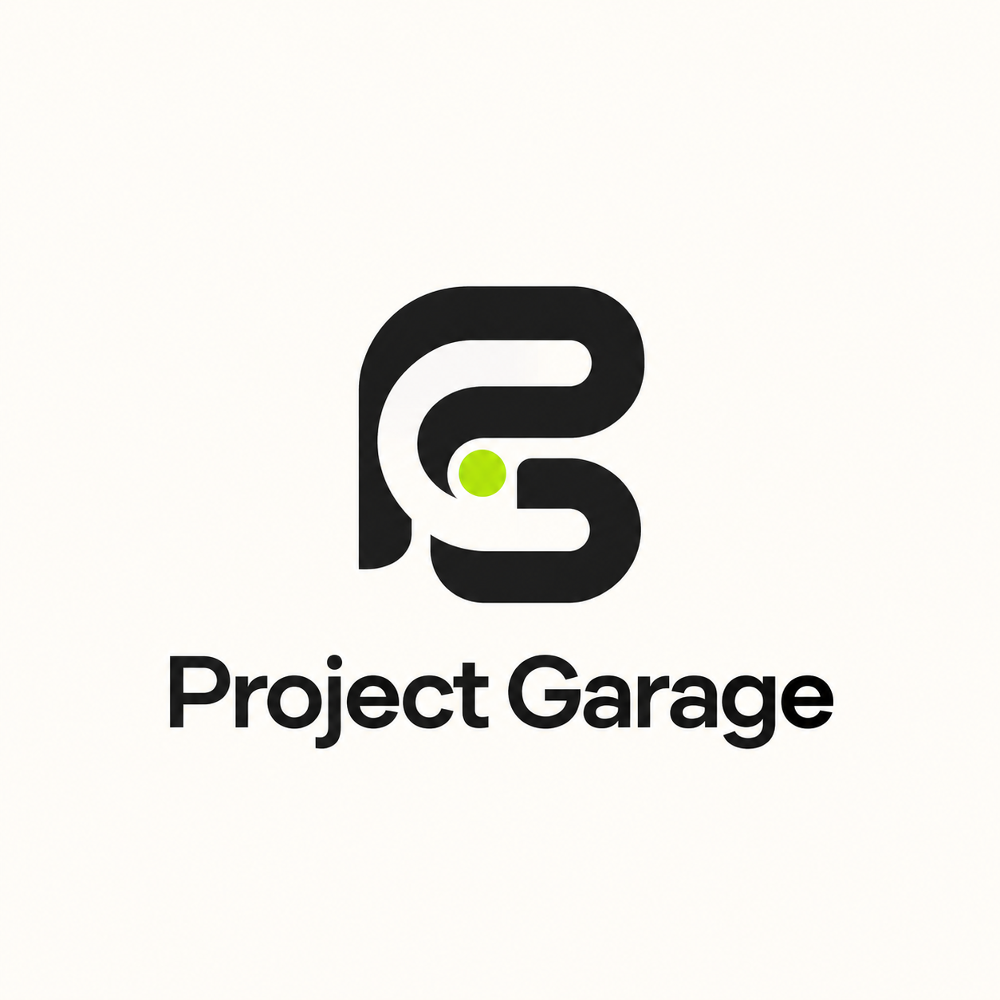

<p align="center">
  
</p>

# Your cars. Your work. Your garage.

Project Garage is a personal project-car tracker built around the work that gets your car finished. Keep a record of the parts you need, what you've bought, what you've spent, and how your build looks along the way.

Android comes first, with a shared Rust foundation and a Tauri 2 app shell for Windows, macOS, and Linux. The interface uses React and TypeScript. The shared-garage service and permission rules run in Rust.

## Build status

The first working version includes the responsive interface, Rust core, SQLite service, account flow, shared-garage permissions, and cross-platform shell. The Android ARM64 debug APK, interface, and native Windows executable build successfully, and all six Rust permission and service tests pass. This is an early development build, not a store-ready Android release. Physical-device testing remains to be done.

**[Download the Android test APK](downloads/project-garage-arm64-debug.apk)** · [Build notes](downloads/README.md)

## What belongs in your garage

- **Your own welcome:** “Opening Kevin's Project Garage.” Your name makes it personal; the owner can rename the garage.
- **Multiple project cars:** keep each car's details, required work, parts, and photo history together.
- **Parts from start to finish:** Needed → Purchased → Received → Installed.
- **Purchase records:** price, purchase date, seller, receipts, and applicable warranty.
- **Total spending:** see what you've actually spent on purchased parts, without labor billing or budget management.
- **Required jobs:** track wiring, paint, alignment, and other work alongside parts.
- **Dated build journal:** notes and photos show how the project came along.
- **Automatic completion:** a project is complete when every approved, required item is done. Optional items and unapproved suggestions do not count.
- **Shared access:** an owner and staff work in the same garage.
- **Offline viewing:** read the most recently saved garage without a connection. Changes require the service to be reachable.

## Owner and staff access

| Action                                      | Owner | Staff                 |
| ------------------------------------------- | ----- | --------------------- |
| Add, remove, or configure cars              | Yes   | No                    |
| Rename or configure the garage              | Yes   | No                    |
| Update approved parts and purchase records  | Yes   | Yes                   |
| Mark parts received or installed            | Yes   | Yes                   |
| Complete approved jobs                      | Yes   | Yes                   |
| Add dated journal entries and photos        | Yes   | Yes                   |
| Suggest parts or work                       | Yes   | Yes, pending approval |
| Approve suggestions or change required work | Yes   | No                    |
| Invite or remove staff                      | Yes   | No                    |

Staff invitations expire after seven days and can be used once. Account passwords are hashed with Argon2. The Rust service checks permissions for every change, and revision checks prevent one person's update from silently overwriting another's.

## Local development

Install a current Rust toolchain and Node.js LTS. On Windows, Rust compilation also needs the Microsoft C++ Build Tools. Native platform prerequisites are described in [Tauri's documentation](https://v2.tauri.app/start/prerequisites/).

```sh
git clone https://github.com/dustindwayne/projectgarage.git
cd projectgarage
npm install
```

Start the Rust service in one terminal:

```sh
cargo run -p garage-server
```

Start the interface in a second terminal:

```sh
npm run dev
```

Open `http://localhost:1420`. Create an owner account to start your garage. Invite staff from the garage settings; they create accounts using the invitation code on the same service.

## Native apps

Keep the garage service running, then start the desktop app:

```sh
npm run tauri dev
```

Build a desktop package on the operating system you're targeting:

```sh
npm run tauri build
```

For Android, install Android Studio, its SDK/NDK, and the required Rust Android targets as described in [the Android prerequisites](https://v2.tauri.app/start/prerequisites/#android). Then:

```sh
npm run tauri android init
npm run tauri android dev
# or
npm run tauri android build -- --apk
```

On Windows, `./scripts/build-android.ps1` builds an ARM64 debug APK and copies it to `artifacts/project-garage-arm64-debug.apk`. It uses Android Studio's Java runtime and includes a file-copy fallback for machines that do not permit symbolic links. The **Android APK** GitHub Actions workflow also builds a downloadable test APK on pushes to `main`.

Native clients connect to the same garage service. Use an HTTPS service address for real devices and shared garages. `localhost` on a phone points to that phone, not your computer. The Android emulator can reach the host computer at `10.0.2.2`; HTTP emulator access is for development only.

## Service configuration

| Variable         | Default                             | Purpose                                |
| ---------------- | ----------------------------------- | -------------------------------------- |
| `GARAGE_BIND`    | `127.0.0.1:3030`                    | Service listen address                 |
| `GARAGE_DB`      | `data/garage.db`                    | SQLite database location               |
| `GARAGE_ORIGINS` | Local development and Tauri origins | Comma-separated allowed client origins |

Build the interface with `npm run build` before using the Rust service to serve it directly at `http://127.0.0.1:3030`. Start the service from the repository root so it can find `dist/`.

For a shared installation, run the service behind an HTTPS reverse proxy, configure allowed origins, and back up the SQLite database. Hosting is not provisioned by cloning the repository. Photos and receipts are stored with the garage in SQLite; images are validated and storage limits are enforced. No analytics, advertising, labor invoicing, or tuning management is included.

## Checks

```sh
cargo test -p garage-core -p garage-server
npm run build
```

## Project layout

```text
crates/garage-core/      Car, part, journal, and permission rules
crates/garage-server/    Rust HTTP service, accounts, sharing, SQLite
src/                    Responsive app interface
src-tauri/              Android and desktop app shell
public/                 Project Garage branding
```

Development takes place on **main**.
